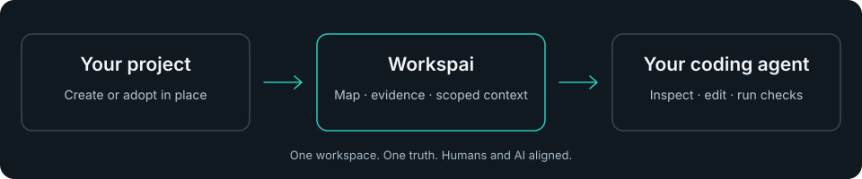

# Workspai CLI

[](https://www.npmjs.com/package/workspai)
[](https://www.npmjs.com/package/workspai)
[](https://github.com/chistiq/workspai/actions/workflows/ci.yml)
[](LICENSE)
[](https://marketplace.visualstudio.com/items?itemName=rapidkit.rapidkit-vscode)

## Give your AI agent the system, not just the repository

**Less rediscovery. More time building.**

Create a structured project or connect your existing code. Prepare focused
context, source references, and relevant checks for your coding agent.

> One workspace. One truth. Humans and AI aligned.

Workspai is an open-source CLI that provides **Workspace Intelligence for software
systems**. Prepare context for Codex, Claude Code, Cursor, or GitHub Copilot, and
inspect the same evidence yourself. The system map and checks do not require an AI API key.

[Start here](#start-with-your-software) · [Agent setup](packages/cli/docs/agent-entry.md) ·
[Documentation](packages/cli/docs/README.md) · [Watch the CLI demo](packages/cli/docs/workspai-grpc-readme-cli.gif)

## Start with your software

Requires **Node.js 20.19+ and npm**. Other runtimes are needed only for the
projects and workflows that use them.

### Connect an existing project

Run from your project's directory:

```bash
npx workspai adopt .
```

Your source stays in place. Workspai adds `.workspai/` metadata and agent entry
files, registers the project in a linked workspace, and prepares its initial map
and context. Review the generated files and terminal summary before committing.
Adoption prepares agent grounding; project health and release readiness are
separate checks.

### Create something new

Start the guided setup:

```bash
npx workspai create
```

Create a **workspace** to organize projects, or create a **project** to choose a
category, starter, and name. After creating an empty workspace, run the command
again to add its first project.

| Build                       | Example starters                                          |
| --------------------------- | --------------------------------------------------------- |
| APIs and services           | FastAPI, NestJS, Go, ASP.NET Core, Rust Axum, Spring Boot |
| Web apps                    | Next.js, React + Vite, Vue, Angular, SvelteKit, Astro     |
| AI agents                   | Google ADK, OpenAI Agents SDK, Microsoft Agent Framework  |
| Model gateways              | OpenRouter with Python or TypeScript                      |
| Desktop apps and extensions | Browse the matching category in the picker                |

Workspai handles scaffolding and workspace registration. The picker shows each
kit's current support status and setup requirements.

[Workspace, project, and import options](packages/cli/docs/creating-workspaces-and-projects.md)

## Give your agent a focused task

Open the created or adopted project in your coding agent and ask for your change
as usual. Generated entry files guide supported hosts to project context; the
host must load those instructions. See [agent setup](packages/cli/docs/agent-entry.md)
for discovery and verification in your host.

To inspect the context yourself, run from the linked project:

```bash
npx workspai agent context --project . --for-agent generic \
  --task "Find the main entry points and available project checks"
```

The JSON packet identifies the selected project and provides source references,
runtime boundaries, and checks discovered from its manifests. It reports missing
or partial evidence explicitly. Preparing context does not edit source or run
tests; your agent performs the work and reports the checks it actually ran.

[](packages/cli/docs/workspai-grpc-readme-cli.gif)

| You want to                | Workspai provides                                          |
| -------------------------- | ---------------------------------------------------------- |
| Understand unfamiliar code | A project map and references you can follow to live source |
| Start an agent task        | Context tied to the selected project and request           |
| Choose the next check      | Manifest-derived commands and recorded findings            |

## Refresh context and inspect health

After your code or configuration changes, refresh the workspace view:

```bash
npx workspai workspace intelligence run --for-agent generic
```

This runs the complete intelligence chain across the linked workspace. Read the
summary for checks that need attention. For a local problem, use
`npx workspai doctor project` from that project; workspace and release checks have
a broader scope.

[Understand runner results](packages/cli/docs/workspace-intelligence-runner.md) ·
[Explore the graph](packages/cli/docs/workspace-knowledge-graph.md)

## From intent to a verified change

For work that needs explicit acceptance criteria or an audit trail, prepare a Goal:

```bash
npx workspai goal "Add retry with exponential backoff" --for-agent generic
```

Workspai prepares scope, acceptance criteria, and an agent handoff.
It prepares governed work; it does not edit source or claim completion.
Your coding agent implements the change under the project's applicable policy.

**Proof-Carrying Change** connects that work to recorded effects and independent
verification:

```text
Intent → baseline → authorization → effects → verification → sealed capsule
```

[Plan a Goal](packages/cli/docs/goal-packs.md) ·
[Follow the complete change workflow](packages/cli/docs/proof-carrying-change.md)

## How it works

The **Workspace Model is the canonical source of truth**. The Knowledge Graph
is a **derived, revision-bound representation**. Providers add facts and evidence
without rewriting the authorizing model during the same run.

Graph matches help locate evidence; they do not prove implementation behavior
or executed tests. A missing relationship means **not proven**, not
"these projects are independent."

<details>
<summary>Architecture and CI usage</summary>

The complete intelligence chain is:

```text
Model → Diff → Impact → Doctor + Contract Verify + Analyze → Readiness
      → Verify → Context → Agent Sync → Explain
```

For CI and machine consumers:

```bash
npx workspai workspace intelligence run --for-agent generic --strict --json
```

`pipeline` is the broader release/governance workflow.
[Runner behavior and exit codes](packages/cli/docs/workspace-intelligence-runner.md)

</details>

## One foundation, many consumers

Use terminal summaries yourself, project context with a coding agent, or JSON
from CI and MCP clients. The [VS Code extension](https://marketplace.visualstudio.com/items?itemName=rapidkit.rapidkit-vscode)
uses the same CLI and workspace artifacts.
Live views observe CLI and Studio activity without turning telemetry into proof.

[See the interactive workspace graph](packages/cli/docs/workspace-graph.gif)

## Go deeper

| Your next step                           | Guide                                                                                                    |
| ---------------------------------------- | -------------------------------------------------------------------------------------------------------- |
| Create, adopt, or import software        | [Getting started](packages/cli/docs/creating-workspaces-and-projects.md)                                 |
| Connect your coding agent                | [Agent entry](packages/cli/docs/agent-entry.md)                                                          |
| Search relationships and source evidence | [Knowledge Graph](packages/cli/docs/workspace-knowledge-graph.md)                                        |
| Automate checks                          | [CI workflows](packages/cli/docs/ci-workflows.md)                                                        |
| Find a command or term                   | [Command reference](packages/cli/docs/commands-reference.md) · [Glossary](packages/cli/docs/GLOSSARY.md) |

[All documentation](packages/cli/docs/README.md)

## Packages

Use **`workspai`** for the CLI. Install once with `npm install -g workspai`
to run `workspai create` directly. **`wspai`** is an optional short npm alias.

## Develop

Start with the [Contribution Hub](.github/CONTRIBUTING.md) and
[Development Guide](packages/cli/docs/DEVELOPMENT.md).
README changes follow the [content contract](packages/cli/docs/README_CONTENT_CONTRACT.md).

## Community

Built by [Chistiq](https://chistiq.com/), the team behind RapidKit and Workspai.

[Ask a question](https://github.com/chistiq/workspai/discussions) ·
[Report a problem](https://github.com/chistiq/workspai/issues) ·
[Changelog](packages/cli/CHANGELOG.md) · [Security policy](packages/cli/docs/SECURITY.md)

## License

MIT. See [LICENSE](LICENSE).
