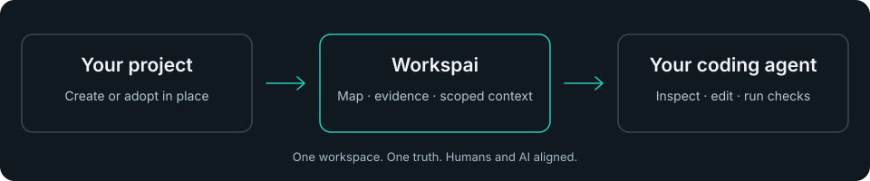

# Workspai CLI

[](https://www.npmjs.com/package/workspai)
[](https://www.npmjs.com/package/workspai)
[](LICENSE)
[](https://marketplace.visualstudio.com/items?itemName=rapidkit.rapidkit-vscode)

## Give your AI agent the system, not just the repository

**Less rediscovery. More time building.**

Create a structured project or connect your existing code. Prepare focused
context, source references, and relevant checks for your coding agent.

> One workspace. One truth. Humans and AI aligned.

Workspai is an open-source CLI that provides **Workspace Intelligence for software
systems**. Prepare context for Codex, Claude Code, Cursor, or GitHub Copilot, and
inspect the same evidence yourself. The system map and checks do not require an AI API key.

[Get started](#choose-your-start) · [Agent setup](docs/agent-entry.md) ·
[Documentation](docs/README.md) · [Watch the CLI demo](https://raw.githubusercontent.com/chistiq/workspai/main/packages/cli/docs/workspai-grpc-readme-cli.gif)

## Choose your start

Requires **Node.js 20.19+ and npm**. Run times depend on the project and checks.
Other runtimes are needed only for projects and workflows that use them;
Python is not required for Python-free workflows.

### Connect an existing project

From your project's directory:

```bash
npx workspai adopt .
```

Your source stays in place. Workspai adds `.workspai/` metadata and agent entry
files, registers the project in a linked workspace, and prepares its initial map
and context. Review the generated files and terminal summary before committing.
Adoption prepares agent grounding; project health and release readiness are
separate checks.

Shared reports live under `.workspai/reports/` in the linked workspace. You can
keep using the source project's terminal. If no workspace was selected, the
adoption summary identifies the default workspace used.

### Create a workspace or a new project

```bash
npx workspai create
```

Create a **workspace** to organize projects, or create a **project** to choose a
category, starter, and name. After creating an empty workspace, run the command
again to add its first project. Workspai handles scaffolding and registration;
the picker shows each kit's current support status and setup requirements.

| Build                       | Example starters                                          |
| --------------------------- | --------------------------------------------------------- |
| APIs and services           | FastAPI, NestJS, Go, ASP.NET Core, Rust Axum, Spring Boot |
| Web apps                    | Next.js, React + Vite, Vue, Angular, SvelteKit, Astro     |
| AI agents                   | Google ADK, OpenAI Agents SDK, Microsoft Agent Framework  |
| Model gateways              | OpenRouter with Python or TypeScript                      |
| Desktop apps and extensions | Browse the matching category in the picker                |

[All workspace, project, and import options](docs/creating-workspaces-and-projects.md)

Prefer a global installation? Run `npm install -g workspai`, then use
`workspai create`. The optional `wspai` package provides the shorter alias.

## Give your agent a focused task

Open the created or adopted project in your coding agent and ask for your change
as usual. Generated entry files guide supported hosts to project context; the
host must load those instructions. Existing sessions may need to reload them.
[Check your host's setup](docs/agent-entry.md).

To inspect what Workspai prepares, run from the linked project:

```bash
npx workspai agent context --project . --for-agent generic \
  --task "Find the main entry points and available project checks" --view route
```

| The JSON route contains                  | Why it matters                                       |
| ---------------------------------------- | ---------------------------------------------------- |
| Selected project and workspace identity  | Check that the context belongs to your target        |
| Targeted source candidates or search     | Follow evidence to live code                         |
| Runtime boundaries and project checks    | Choose checks from the affected package's manifests  |
| Scoped guidance and evidence limitations | See what is usable and what needs further inspection |

Preparing context does not edit source or run tests. Your agent implements the
change and reports the checks it actually ran. Missing or partial evidence is
reported explicitly; it does not prove that source is absent.

[](https://raw.githubusercontent.com/chistiq/workspai/main/packages/cli/docs/workspai-grpc-readme-cli.gif)

## Refresh context and inspect health

After changing code or configuration, refresh the workspace view:

```bash
npx workspai workspace intelligence run --for-agent generic
```

This runs the complete intelligence chain across the linked workspace. A blocked
result names a check that needs attention; inspect the summary and its report.
A successful adoption or context request does not certify release readiness.

For a project-local problem, run from that project:

```bash
npx workspai doctor project
```

Use `npx workspai doctor workspace` for workspace-wide diagnostics.
[Runner behavior and results](docs/workspace-intelligence-runner.md) ·
[Doctor guide](docs/doctor-command.md)

## Everyday workflows

| You want to                   | Start with                                                             |
| ----------------------------- | ---------------------------------------------------------------------- |
| Prepare task context          | `npx workspai agent context --project . --task "Explain this project" --view route` |
| Run a new-project wizard      | `npx workspai create`                                                  |
| Inspect project membership    | `npx workspai project workspace status --json`                         |
| Refresh generated entry files | `npx workspai workspace agent-sync --write --refresh-context --json`   |
| Connect an MCP client         | `npx workspai workspace mcp serve`                                     |

<details>
<summary>Search graph evidence for one project</summary>

Replace `<project-name>` with the project name reported in your task context.
Keep the explicit scope when several projects share a workspace:

```bash
npx workspai workspace graph search "authentication" \
  --scope "project:<project-name>" --limit 5 --view agent --json
```

Matches are discovery evidence. Follow their source references before changing
code. No lexical match is not proof that an implementation is absent.

[Graph search and evidence](docs/workspace-knowledge-graph.md)

</details>

[All commands and flags](docs/commands-reference.md)

## Plan work and verify governed changes

For work needing explicit acceptance criteria or an audit trail, prepare a Goal:

```bash
npx workspai goal "Add retry with exponential backoff" --for-agent generic
```

Workspai prepares scope, acceptance criteria, and an agent handoff.
The command does not edit source or claim completion. Your agent implements the
change under the project's applicable policy.

**Proof-Carrying Change** connects governed work to recorded effects and independent
verification:

```text
Intent → baseline → authorization → effects → verification → sealed capsule
```

Prediction can guide work but can never prove its own result. A prepared Goal
or an applied edit is not a verified outcome. Follow the complete workflow when
project policy or change scope requires it.

[Plan a Goal](docs/goal-packs.md) · [Record and verify a change](docs/proof-carrying-change.md) ·
[Watch the governed-change demo](https://raw.githubusercontent.com/chistiq/workspai/main/packages/cli/docs/workspai-pcc-readme-cli.gif)

## How Workspace Intelligence works

The **Workspace Model is the canonical source of truth**. The Knowledge Graph
is a **derived, revision-bound representation**. Providers add facts and evidence
without rewriting the authorizing model during the same run.

A missing relationship means **not proven**, not "these projects are independent."
Graph matches do not prove implementation behavior or executed tests.

<details>
<summary>The full intelligence chain and CI command</summary>

```text
Model → Diff → Impact → Doctor + Contract Verify + Analyze → Readiness
      → Verify → Context → Agent Sync → Explain
```

```bash
npx workspai workspace intelligence run --for-agent generic --strict --json
```

`pipeline --json --strict` is the broader release/governance workflow.
[Runner behavior and exit codes](docs/workspace-intelligence-runner.md)

</details>

## Outputs and integrations

Use terminal summaries yourself, JSON in automation, and saved project context
with coding agents. Graph exports include JSON, Mermaid, DOT, GraphML, and GEXF.
Live activity projections and reports for IDEs and dashboards show current
activity; activity alone does not prove correctness.

The [VS Code extension](https://marketplace.visualstudio.com/items?itemName=rapidkit.rapidkit-vscode)
uses the same CLI and workspace artifacts.
[See the interactive graph](https://raw.githubusercontent.com/chistiq/workspai/main/packages/cli/docs/workspace-graph.gif).

## Documentation

| Your next step                           | Guide                                                                          |
| ---------------------------------------- | ------------------------------------------------------------------------------ |
| Create, adopt, or import software        | [Getting started](docs/creating-workspaces-and-projects.md)                    |
| Connect your coding agent                | [Agent entry](docs/agent-entry.md)                                             |
| Search relationships and source evidence | [Knowledge Graph](docs/workspace-knowledge-graph.md)                           |
| Automate checks                          | [CI workflows](docs/ci-workflows.md)                                           |
| Find a command or term                   | [Command reference](docs/commands-reference.md) · [Glossary](docs/GLOSSARY.md) |

[Browse all guides](docs/README.md)

## Troubleshooting

- **Workspace not detected?** Run from the linked project and inspect
  `npx workspai project workspace status --json`.
- **Your agent does not use the entry files?** Open the project as its workspace
  and follow the [host setup guide](docs/agent-entry.md).
- **Context is stale?** Rerun the intelligence command above.
- **A project check cannot start?** Inspect that project's runner and dependencies
  with `npx workspai doctor project`; setup limitations are separate from failed tests.

## Contributing

[Contribution guide](CONTRIBUTING.md) · [Development](docs/DEVELOPMENT.md) ·
[Security](docs/SECURITY.md)

Built by [Chistiq](https://chistiq.com/), the team behind RapidKit and Workspai.
RapidKit Core supports Python/Core-dependent kits and modules. The current
RapidKit Core release requires Python 3.11 or newer; Workspai workflows that do
not use RapidKit Core remain Python-free.

## License

MIT. See [LICENSE](LICENSE).
